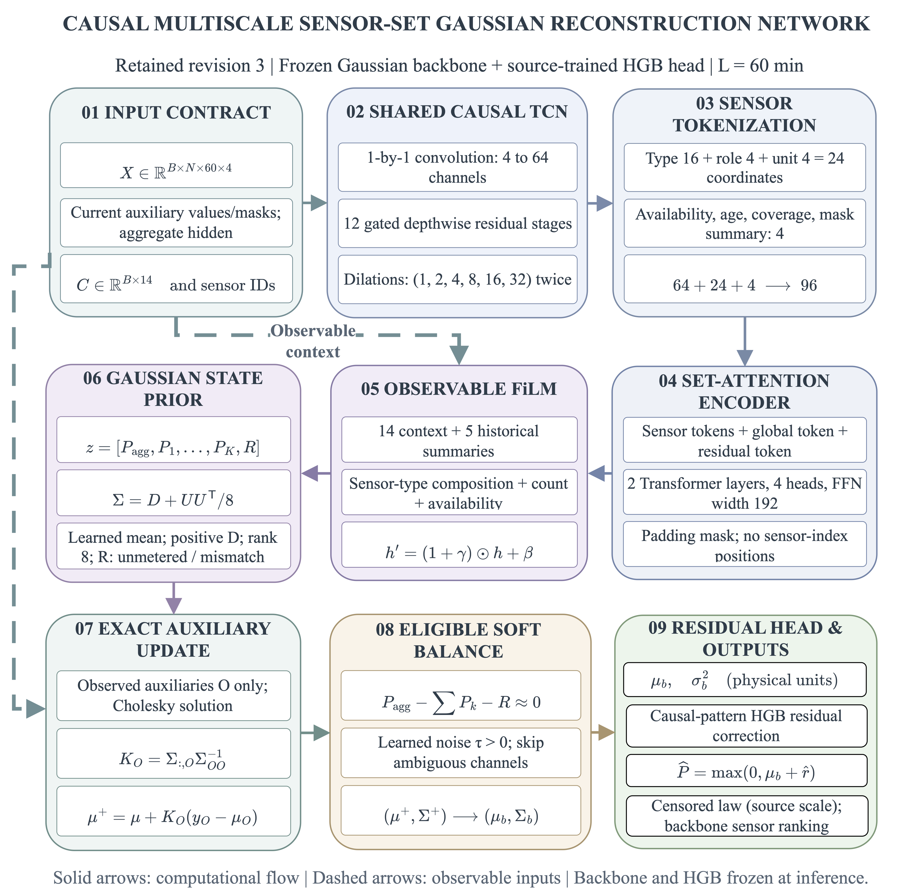
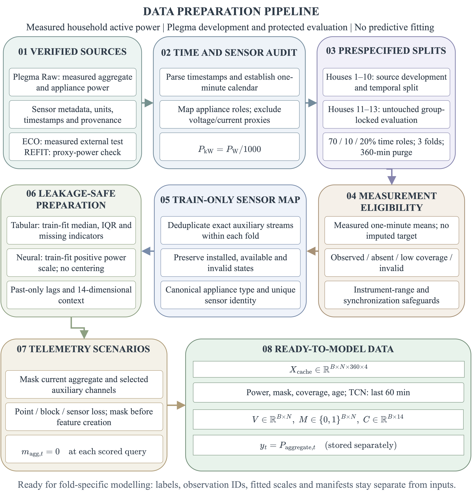
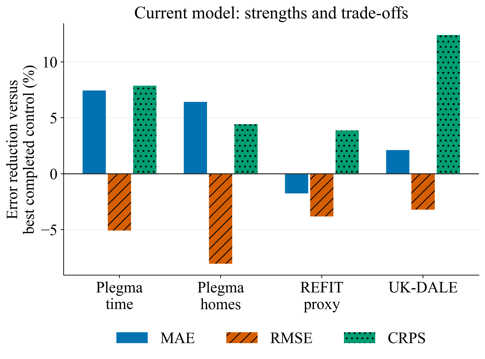

# Aggregate Power Reconstruction under Incomplete Telemetry

Probabilistic reconstruction of the current household aggregate active power when the main meter reading is unavailable and auxiliary sensor telemetry is incomplete, with uncertainty quantification, selective reconstruction and cost-aware selection of additional measurements.

This is a reconstruction task, not load forecasting. The aggregate power of the completed minute exists as a real measurement and is used as ground truth, but it is hidden from the model. The model sees only past measurements and the auxiliary sensors that are available at the current minute.

<p align="center">
  
</p>

## Contents

- [Problem setting](#problem-setting)
- [Method](#method)
- [Data and evaluation design](#data-and-evaluation-design)
- [Results](#results)
- [Repository structure](#repository-structure)
- [Running the notebooks](#running-the-notebooks)
- [Limitations](#limitations)

## Problem setting

| Item | Definition |
|---|---|
| Target | Mean aggregate active power of the current completed 1-minute interval, in kW |
| Permitted inputs | Aggregate history up to the previous minute, currently available appliance-level readings, observation masks, time since last valid reading, coverage, calendar encodings, sensor metadata |
| Forbidden inputs | The current aggregate value or any function of it, future values, centred windows, backward filling |
| Telemetry loss | Simulated on real measurements: point, block (5, 30, 120 min), whole-sensor dropout and mixed patterns; auxiliary availability 100, 75, 50, 25 and 0% |
| Primary metric | House-macro MAE (every household has equal weight) |
| Secondary metrics | RMSE, bias, CRPS, 95% interval coverage and width, selective MAE |

## Method

The proposed model has two stages.

1. **Causal sensor-set backbone.** Each sensor history (power, mask, age, coverage) is encoded by a shared causal temporal encoder. Sensor tokens carry semantic type embeddings instead of positional indices, so the model accepts a variable and unordered set of sensors. The backbone outputs a joint Gaussian state over the aggregate and auxiliary channels, which is conditioned analytically on the auxiliary readings available at the current minute.
2. **Causal pattern residual correction.** A gradient-boosted residual learner (absolute-error loss) corrects the backbone mean using causal recent-level, freshness and load-change features together with the backbone mean and standard deviation. The final point estimate is constrained to be non-negative.

For the joint Gaussian state, the value of an additional measurement is formulated with a success probability and a request cost. Computable bounds on the expected reduction of the squared Bayes risk for the rectified (non-negative) power are derived from a Hermite expansion and used for one-step measurement selection and stopping.

## Data and evaluation design

| Dataset | Households | Role |
|---|---|---|
| Plegma | 10 | Development (three expanding-window folds), calibration, temporal hold-out |
| Plegma | 3 | Unseen-house hold-out |
| REFIT | external | Zero-shot transfer (nominal power readings) |
| UK-DALE | external | Zero-shot transfer (measured active power) |
| ECO | 6 | Independent zero-shot evaluation, opened after the model was fixed |

Each Plegma development house is split by calendar time into 70% development, 10% calibration and 20% temporal hold-out, with a 360-minute purge between partitions. Hyperparameters are selected on inner validation only. All results are averaged over three seeds (17, 43, 101). Preprocessing is fitted separately inside each training fold. Download instructions are in [`dataset/README.md`](dataset/README.md).

<p align="center">
  
</p>

## Results

All values are computed from saved predictions; full tables are in [`artifacts/tables`](artifacts/tables).

### Development (out-of-fold, 10 Plegma households)

| Model | MAE (kW) | RMSE (kW) | Bias (kW) |
|---|---:|---:|---:|
| **Proposed model** | **0.0951** | 0.3496 | −0.0386 |
| Cost-sensitive selector | 0.0994 | 0.3459 | −0.0202 |
| Expected-error-difference selector | 0.0998 | 0.3466 | −0.0210 |
| Observable-age selector | 0.1093 | 0.3405 | −0.0070 |
| ExtraTrees | 0.1158 | **0.3357** | −0.0067 |
| Causal Transformer | 0.1170 | 0.3667 | −0.0542 |
| Causal TCN | 0.1178 | 0.3708 | −0.0561 |
| ImputeFormer (semantic) | 0.1200 | 0.3830 | −0.0381 |
| SAITS (prefix) | 0.1201 | 0.3771 | −0.0580 |
| BRITS (prefix) | 0.1266 | 0.3800 | −0.0644 |

The proposed model has the lowest MAE, 4.3% below the strongest baseline; this difference is not significant after Holm correction (p = 0.078). ExtraTrees has the lowest RMSE. CSDI was not completed within the compute budget and is not ranked.

### Component controls (development)

| Control | Control MAE (kW) | MAE reduction by the full model | Holm-adjusted p |
|---|---:|---:|---:|
| Backbone without residual correction | 0.1208 | 21.22% | 0.0117 |
| Residual correction without recent-pattern inputs | 0.1104 | 13.81% | 0.0117 |
| Persistence anchor with the same residual learner | 0.1004 | 5.25% | 0.0039 |

Exact paired tests over the 10 development households with Holm correction. The comparisons support the tested component bundles, not the necessity of every internal layer.

### Hold-out and external evaluation

| Domain | Proposed MAE | Best competitor MAE | Proposed RMSE | Best competitor RMSE | Proposed CRPS | Best competitor CRPS |
|---|---:|---:|---:|---:|---:|---:|
| Plegma, temporal hold-out | **0.0718** | 0.0776 | 0.2584 | **0.2460** | **0.0645** | 0.0700 |
| Plegma, unseen houses | **0.1232** | 0.1316 | 0.3849 | **0.3562** | **0.1084** | 0.1134 |
| REFIT, zero-shot | 0.1600 | **0.1572** | 0.4856 | **0.4677** | **0.1390** | 0.1446 |
| UK-DALE, zero-shot | **0.0856** | 0.0874 | 0.2824 | **0.2736** | **0.0730** | 0.0834 |
| ECO, independent zero-shot | 0.1449 | **0.1401** | 0.4436 | **0.4322** | **0.1262** | 0.1322 |

All values in kW; "best competitor" is the best of the compared baselines for that metric and domain. The first four domains were inspected before the residual correction was finalised and are therefore retrospective for the final model. ECO is the only domain evaluated after the model was fixed.

<p align="center">
  
</p>

### Independent ECO evaluation: statistical outcome

| Quantity | Result |
|---|---|
| Prespecified global criterion (MAE and RMSE against all six controls) | Not met (p = 0.984) |
| Pairwise contrasts significant after Holm correction (18 tests) | 0 of 18 |
| MAE lower than the control (point estimate) | 4 of 6 controls |
| RMSE lower than the control (point estimate) | 2 of 6 controls |
| CRPS lower than the control (point estimate) | 6 of 6 controls |
| Selective MAE at 50% retained queries | 0.0477 kW (next best 0.0697 kW) |

With six households the test has low power; the absence of a significant difference is not evidence of equivalence.

### Calibrated 95% prediction intervals

| Domain | Coverage | Mean width (kW) | Interval score (kW) |
|---|---:|---:|---:|
| Plegma, temporal hold-out | 0.953 | 0.427 | 1.266 |
| Plegma, unseen houses | 0.926 | 0.578 | 2.098 |
| REFIT, zero-shot | 0.944 | 0.844 | 2.365 |
| UK-DALE, zero-shot | 0.961 | 0.551 | 1.197 |
| ECO, independent zero-shot | 0.928 | 0.667 | 2.317 |

Intervals are calibrated on source (Plegma) data only. The uncalibrated predictive distribution under-covers (0.81 to 0.88 on the same domains).

### Computational cost

On ECO, inference of the proposed model for one seed took about 55 s on an Apple MPS device with four CPU threads and batch size 32, against about 11 s for the causal Transformer; peak process memory was about 1.0 GiB. See [`resource_measurements.csv`](artifacts/tables/eco_independent/resource_measurements.csv).

## Repository structure

```text
├── README.md
├── environment.yml              Conda environment used for all runs
├── requirements-lock.txt        Exact package versions
├── dataset/                     Data descriptors, split definitions, download instructions
├── notebooks/                   Six executed notebooks with stored outputs
├── artifacts/
│   ├── configs/                 Experiment protocol, search spaces, final model configuration
│   └── tables/                  Final result tables (CSV)
│       ├── development/
│       ├── retrospective/
│       └── eco_independent/
└── figures/                     Figures 1–29
```

| Notebook | Content |
|---|---|
| `01_dataset_analysis_and_research_design` | Source semantics, timestamp and quality analysis, split design, minute-level target construction |
| `02_feature_analysis_and_leakage_safe_preprocessing` | Causal feature construction, invariance tests, fold-local preprocessing, dependence and missingness analysis |
| `03_baseline_models_and_error_diagnostics` | Naive, statistical and tree baselines, learned selectors, error diagnostics |
| `04_modern_models_and_comparative_diagnostics` | Causal TCN, causal Transformer, BRITS, SAITS, ImputeFormer under the same information boundary |
| `05_proposed_model_development_and_ablations` | Proposed model, value-of-information derivation, component controls, rejected alternatives |
| `06_frozen_evaluation_statistics_and_publication_results` | Hold-out, external and independent evaluation, interval calibration, statistical tests |

Figures are numbered 1–29. Figures 1 and 19 are schematic diagrams; the remaining figures are produced by the notebooks.

## Running the notebooks

```bash
conda env create -f environment.yml
conda activate ai-pytorch-mps
jupyter lab
```

Main dependencies: Python 3.11, PyTorch 2.11, scikit-learn 1.8, CatBoost 1.2, pandas 2.3, NumPy 2.4, Matplotlib 3.10.

The notebooks are distributed as executed records, so every table and figure can be inspected without running anything. Re-execution has the following requirements.

- The raw datasets must be downloaded and placed as described in [`dataset/README.md`](dataset/README.md).
- The notebooks run in order from 01 to 06. Each one reads products written by the previous ones into working folders at the repository root (`Data/`, `Configs/`, `Manifests/`, `Models/`, `Predictions/`, `Tables/`, `Figures/`). These working folders, including intermediate caches, trained checkpoints and saved predictions, total about 44 GB and are not part of this repository.
- Several cells assert SHA-256 values of the checkpoints and predictions of the recorded run. A fresh run on other hardware will produce numerically different artefacts, and these assertions then need to be updated.
- Figures require the Times New Roman font.
- Recorded runs used an Apple MPS device for neural models and four CPU threads for classical models. Timings refer to that workstation.

## Limitations

- The development population is 10 households from one country; the independent evaluation has 6 households. Statistical power is low and results should not be generalised to other building stocks without further evaluation.
- Telemetry loss is simulated on real measurements. The results describe the stated mixture of simulated outage patterns, not the natural prevalence of outages.
- Overall superiority of the proposed model is not established. It has the lowest CRPS on all five evaluation domains and the lowest MAE on three, but not the lowest RMSE on any, and it has a negative bias.
- Four of the five evaluation domains are retrospective for the final model.
- REFIT aggregate readings are nominal power from a fixed-voltage current clamp and are not equivalent to measured active power.
- Appliance coverage is incomplete in every household, and negative aggregate-minus-submeter residuals occur, so a hard power-balance constraint is not supported by the data.
- The measurement-selection bounds hold for one-step decisions under the model's conditional Gaussian assumption; they are not multi-step optimality guarantees.
- CSDI was not completed and no conclusion about it is drawn.
